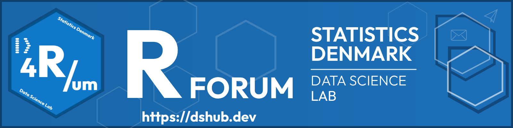

<p align="center">
  <a href="https://dshub.dev"></a>
</p>

# 4R/um: a monthly R exchange meeting at Statistics Denmark

**🌐 Website: <https://dshub.dev>**

4R/um is the monthly R forum at [Statistics Denmark](https://www.dst.dk) (DST), run by the [Data Science Lab](https://www.dst.dk/da/TilSalg/data-til-forskning/data-science-lab). Meetings usually take place on the 4th Friday of the month. They cover R, Quarto, reproducible workflows, and open-source data science. Every now and then we host guest speakers and joint events with the [CopenhagenR useR Group](https://www.meetup.com/copenhagenr-user-group).

The website has:

- [**Meetings**](https://dshub.dev/#meetings): every session with its speakers, topics, and slides
- [**Newsletter**](https://dshub.dev/newsletter.html): a monthly selection of R packages, tools, and reads
- [**About**](https://dshub.dev/about.html): the format, logistics, and how to get in touch

DST colleagues can find the full internal meeting materials at `Q:/Rforum`.

## Repository layout

| Path | Contents |
|---|---|
| `index.qmd`, `newsletter.md`, `about.qmd` | Website pages (Quarto sources) |
| `_quarto.yml`, `styles.css` | Site configuration and custom styling (Bootswatch *Sketchy* theme) |
| `slides/` | Self-contained HTML slide decks from past meetings, published as-is |
| `img/` | Banners, logo, and newsletter social cards |
| `docs/` | Rendered site, served by GitHub Pages; **do not edit by hand** |
| `announcements.md` | Drafts of meeting invitations (not part of the site) |

## Building the site

You need [Quarto](https://quarto.org) ≥ 1.4.

```bash
quarto preview   # live preview while editing
quarto render    # build into docs/, then commit and push
```

GitHub Pages serves the `docs/` folder on `main`. The custom domain is set in the root `CNAME` file, and Quarto copies it into `docs/` on every render. Edit the root `CNAME`, not `docs/CNAME`.

### Adding a meeting

1. Add a `::: {.meeting-card}` block at the top of the *Meetings* section in `index.qmd`.
2. If there are slides, put the self-contained HTML in `slides/` (naming convention: `YYMM-slides-<speaker>.html`) and link it as `/slides/<file>.html`.
3. Run `quarto render` and commit both the sources and `docs/`.

## Contact

Organized by [Ilya Kashnitsky](https://ikashnitsky.phd). Ideas for talks, or want to present? [Get in touch](https://bio.link/ikx).

## License

See [LICENSE](LICENSE).
