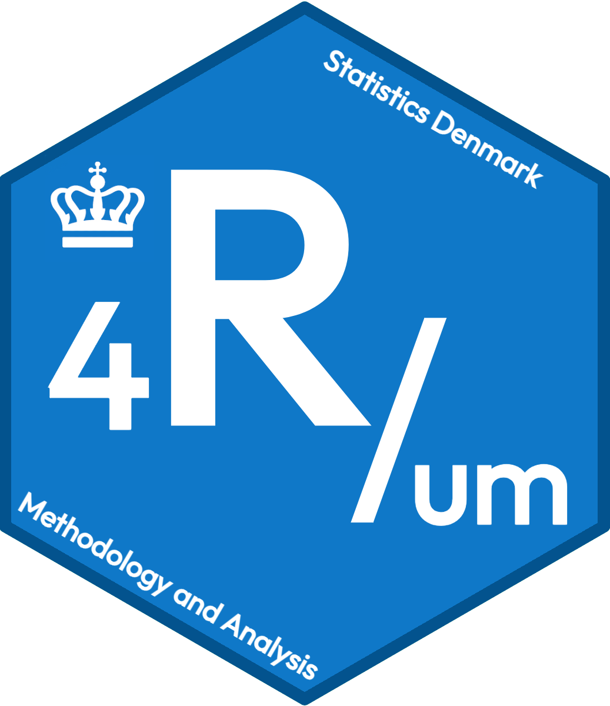

::: {.hero-banner}
{.hero-logo style="max-width: 180px;" alt="4R/um Hex Logo"}

### Welcome to 4R/um!

A monthly R exchange meeting and discussion club at Statistics Denmark.
:::

::: {.callout-note}
### Accessing Materials
- **Internal**: R forum meeting materials can be found locally on the internal network at `Q:/Rforum`. Each meeting has its own subfolder; if the subfolder is empty, there were no materials to share at that particular meeting.
- **Open / External**: Meeting materials that are open source and of interest to a wider audience are shared or linked here in this repository.
:::

---

# Meetings

All 4R/um meetings are held monthly. Below is the chronological record of sessions, speakers, topics, and shared materials.

::: {.meeting-card}
### 2026-10-23 -- Joint meeting with CopenhagenR useR Group
Joint meeting organized together with [CopenhagenR useR Group via Meetup](https://www.meetup.com/copenhagenr-user-group).

- **Aksel Thomsen** (Novo Nordisk): *Open Source R development at Novo: Why are we doing it, and a short introduction to our packages.*
- **Greger Dubrow** (DTU Food): *Using R at DTU Food -- metadata, real-time analysis, and training.*
- **Emil Thranholm** (Statistics Denmark): *History, current use, and future development of R at Statistics Denmark, with a focus on the local setup, when servers running the computations are detached from the internet.*
:::

::: {.meeting-card}
### 2026-09-25 -- Thomas Lin Pedersen: ggsql
Guest talk by [Thomas Lin Pedersen](https://www.data-imaginist.com/about) (Posit), lead developer of [{ggplot2}](https://ggplot2.tidyverse.org/) and author of `{ggforce}`, `{patchwork}`, `{ragg}`, `{ggraph}`, `{ggfx}`, and `{gganimate}`.

- **Topic**: [{ggsql}](https://ggsql.org) -- bridging ggplot2 syntax with SQL-native workflows.
- [Presentation Slides](https://thomasp85.github.io/2026_ggsql_4rum){.btn .btn-outline-primary .btn-sm target="_blank"}
:::

::: {.meeting-card}
### 2026-06-26 -- IKX: fastverse
Presentation on high-performance computing in R: speeding up data processing 20x to 100x+.

- [Fastverse](https://fastverse.org/){target="_blank"}
- [{collapse}](https://sebkrantz.github.io/collapse/){target="_blank"} -- Advanced and fast data transformation
- [{polars}](https://pola-rs.github.io/r-polars/){target="_blank"} -- Blazingly fast DataFrame library in R
:::

::: {.meeting-card}
### 2026-05-29 -- IKX: SAS to R conversion
Ilya Kashnitsky presents an approach to converting SAS code to R.

- **Artifacts**: HTML rendering of the material (`sas-to-r-dst.html`).
:::

::: {.meeting-card}
### 2026-04-24 -- JOC & IKX: R course feedback
Joint session by JOC and IKX reviewing feedback from the in-house R onboarding course.

- **Topic**: Retrospective on departmental R adoption and onboarding.
:::

::: {.meeting-card}
### 2026-03-27 -- IKX: DB connection speed
Benchmarks for reading and writing Oracle tables from R (`ROracle` vs `ODBC`) against the STATPROD database.

- **Artifacts**: Quarto report `test-speed.qmd` (rendered `test-speed.html`) comparing fetch sizes, column and date encodings, and an optimized write function (`write_oracle_optimized()`), with helper scripts for encoding and writing/reading.
:::

::: {.meeting-card}
### 2026-02-27 -- IKX: Parquet
Using the `arrow` package to write and read Parquet files, compared with CSV for speed and file size.

- **Artifacts**: Based on the `diamonds` dataset in `using-arrow-parquet.R`, with supporting import/export functions in `functions-parquet-import-export.R`.
:::

::: {.meeting-card}
### 2025-11-28 -- PHP: dstmetadata
Presentation by PHP on the `dstmetadata` package for working with metadata from Statistics Denmark.

- **Artifacts**: PowerPoint file (`r_forum_DSTmetadata.pptx`).
:::

::: {.meeting-card}
### 2025-10-24 -- JHD: VS Code
Presentation by JHD on working with VS Code and R.

- **Artifacts**: Slides in `2025-10-23_R-forum-roundtable.pptx` (subfolder also contains `AYB-sas`).
:::

::: {.meeting-card}
### 2025-09-26 -- IKX: Quarto
Introduction to Quarto for scientific and technical publishing.

- **Artifacts**: Reveal.js slide deck (`slides-4rum-ikx-quarto.qmd`) using the dark theme with `zenburn` highlighting and embedded resources.
:::

::: {.meeting-card}
### 2025-05-16 -- MNT: Maps DK
Crafting municipality (*kommune*) maps of Denmark in R, including a custom ggplot theme and helper functions in Danish and English.

- **Artifacts**: R scripts (`Kommunekort_skabelon.R`, `ggplot_tema.R`, `funktioner_da.R` / `funktioner_en.R`), example maps (`map_70.png`, `map_70.svg`), the presentation, and a Word document describing the functions.
:::
